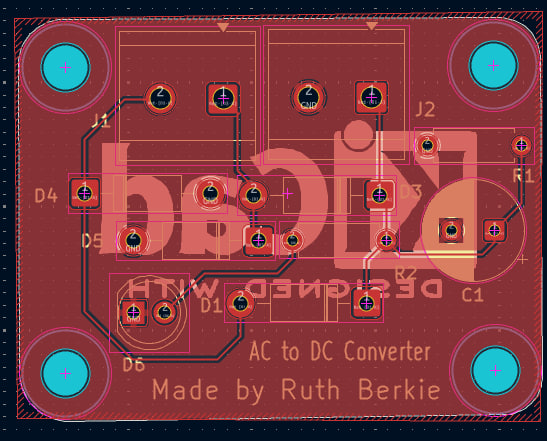
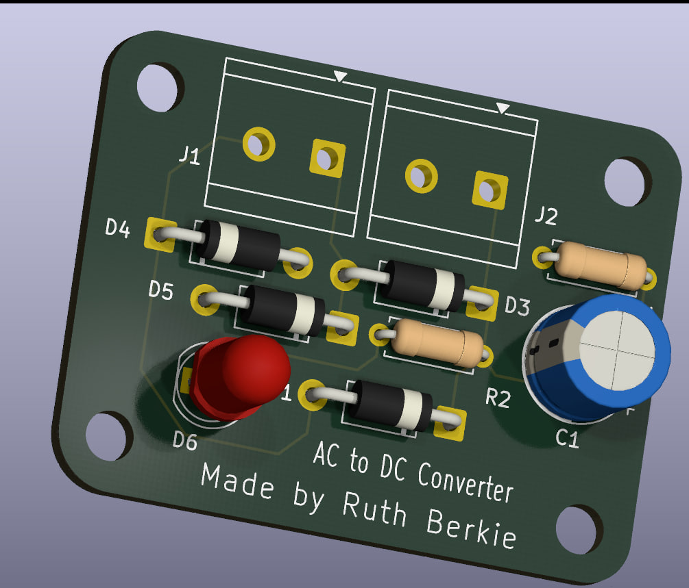

This schematic represents a standard linear DC power supply circuit featuring a full-wave bridge rectifier, smoothing filter, and visual power indicator. Its main purpose is to convert alternating current (AC) input into a smooth, stable direct current (DC) output.

1. Component Breakdown & Their Roles

       • J1 (Screw_Terminal_01x02): The AC power input terminal. connecting the external low-voltage AC source, typically coming from a step-down transformer.
       • D1, D3, D4, D5 (1N4007 Diodes): These four diodes form a Full-Wave Bridge Rectifier. Diodes only allow current to flow in one direction. Together, they redirect both the positive and negative halves of the alternating AC wave into a single positive direction, converting AC into pulsating DC.
       • C1 (1000µF Capacitor): The Smoothing/Filter Capacitor. Rectified DC still has massive voltage drops (ripples). C1 stores electrical energy during voltage peaks and releases it during voltage drops, flattening the pulses into a clean, steady DC voltage.
       • R1 (10kΩ Resistor): A Bleeder Resistor. When you turn off or unplug the circuit, C1 can hold a dangerous electrical charge for a long time. R1 provides a safe, continuous path to completely discharge the capacitor when power is disconnected.
       • R2 (2.2kΩ Resistor) & D6 (LED): The Power Indicator. The LED lights up to show that the board is powered and functioning. Because an LED cannot handle raw supply voltage directly, R2 acts as a current-limiting resistor to prevent the LED from burning out.
       • J2 (Screw_Terminal_01x02): The DC power output terminal. This delivers the final, rectified, and smoothed DC voltage to whatever device or external circuit you want to power.
       • H1–H4 (MountingHoles): These are physical holes on the circuit board for screws. They have no electrical function but are used to securely mount the physical PCB into an enclosure.
       • PWR_FLAG & GND: Technical labels used in schematic software (like KiCad). GND establishes the 0V reference line (Ground), while PWR_FLAG informs the software's error-checker that power is properly defined on this net.

The layout follows a logical, left-to-right progression of power processing:
[AC Input: J1] ➔ [Rectification: D1-D5] ➔ [Filtering: C1] ➔ [Bleeding/Indicating: R1, R2+D6] ➔ [DC Output: J2]

    • The AC to Bridge Connections: The two input wires from J1 connect directly to the midpoints of the diode pairs (between D1/D4 and D3/D5). This ensures that regardless of which AC wire is positive at any microsecond, the current is always steered correctly.
    
• Creating the DC Rails:

	• The cathodes (the side with the line symbol) of D1 and D3 join together at the top. This becomes the Positive (+) DC Rail.
	• The anodes of D4 and D5 join together at the bottom. This becomes the Negative (-) DC Rail / Ground.
  
• The Parallel Layout: Components C1, R1, and the R2+D6 branch are connected in parallel across the positive and negative rails.

	• Connecting C1 in parallel allows it to act as a voltage reservoir directly stabilizing the main power lines.
	• Connecting R1 and the LED indicator branch in parallel ensures they continuously experience the full system voltage without blocking current from reaching the final output terminal, J2.

 

  step-by-step summary of how the entire circuit processes electricity from start to finish:
  
    1. The Input: Alternating Current (AC voltage) enters the circuit through the J1 terminal block on the far left. At this stage, the voltage is constantly fluctuating up and down, reversing its direction multiple times per second.
    2. Rectification: The electricity immediately flows into the Bridge Rectifier (D1, D3, D4, D5). These four diodes act like one-way electrical valves. They redirect the negative halves of the shifting AC wave into the positive direction, transforming it into pulsating Direct Current (DC). 
    3. Smoothing: The pulsating DC moves to the C1 Capacitor. Because the voltage is still pulsing rapidly, the capacitor acts like a temporary water reservoir—it quickly charges up during voltage peaks and discharges energy during the drops. This heavily filters the electrical "ripple," flattening the pulses into a smooth, stable DC voltage.
    4. Safety & Indicator: On its way to the exit, the smooth DC power runs across R1 and R2+D6.
         	• D6 (the LED) lights up to visually confirm the board is active, while R2 keeps the LED from pulling too much current and burning out.
         	• R1 (the bleeder) acts as a safety drain, slowly emptying the stored electrical energy inside the capacitor once the main power source is disconnected.
    5. The Output: The finalized, clean, and reliable DC power exits through the J2 terminal block on the far right, ready to safely run your electronics.

 FINAL RESULT

  
